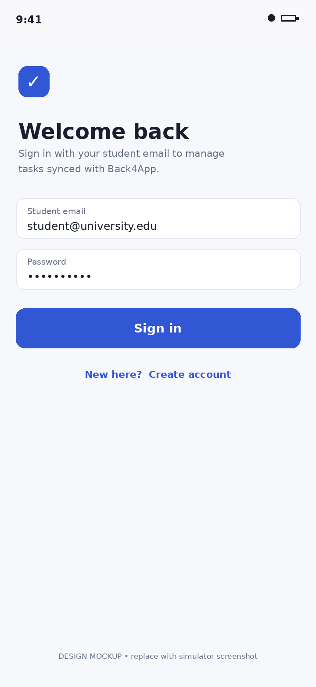
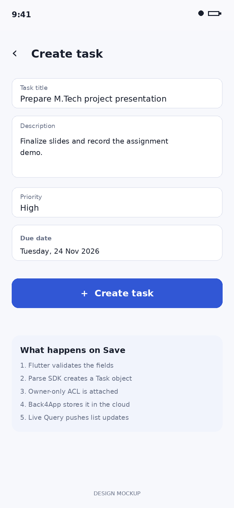

# M.Tech Task Manager — Flutter iOS + Parse Server

A polished iOS-first Flutter Task Manager developed for the **SE ZG585 assignment**.

The application uses the **Parse Flutter SDK** with an **open-source Parse Server deployed on Railway** and **MongoDB** for authentication, persistent cloud task storage, CRUD operations, sessions, and owner-specific ACL authorization.

> **Current backend:** Parse Server on Railway + MongoDB  
> **Backend administration:** Parse Dashboard  
> **Original managed Parse target:** Back4App (see the deployment note below)

## Features

- Student email registration and login
- Persistent Parse user sessions
- Create, read, edit, complete, search, filter, and delete tasks
- Priority selection and optional due dates
- Total / Active / Done dashboard statistics
- Cloud persistence using Parse Server and MongoDB
- Authenticated standard Parse queries
- Owner-specific ACL on every user-created task
- Secure logout
- iOS-friendly Flutter interface
- Runtime backend configuration using `--dart-define`
- Secrets excluded from source control
- Flutter unit tests for validation rules
- GitHub Actions CI for analysis and tests

## Interface Preview

The screenshots below demonstrate the Flutter iOS application.

| Login | Dashboard | Create Task |
|:---:|:---:|:---:|
|  |  |  |

The dashboard screenshot is captured from the working iOS application connected to the deployed Parse Server backend on Railway with MongoDB persistence.

> Before final submission, the remaining design mockups can be replaced with real simulator screenshots without changing the application implementation.

## Technology Stack

| Layer | Technology |
|---|---|
| Mobile Application | Flutter / Dart |
| Target Platform | iOS |
| Client SDK | Parse Flutter SDK |
| Backend | Open-source Parse Server |
| Backend Hosting | Railway |
| Database | MongoDB |
| Authentication | Parse `_User` and sessions |
| Authorization | Parse ACL |
| Administration | Parse Dashboard |
| Testing | Flutter Test |
| CI | GitHub Actions |
| Source Control | Git / GitHub |

## Architecture

```text
Flutter iOS Application
        |
        | Parse Flutter SDK / HTTPS
        v
Parse Server on Railway
        |
        v
MongoDB

Administration: Parse Dashboard
```

The Flutter application communicates with Parse Server through the Parse Flutter SDK. Parse Server manages authentication, sessions, object persistence, queries, and ACL authorization. MongoDB provides persistent data storage, while Parse Dashboard is used to inspect and administer backend data.

## Backend Deployment

The currently running backend is an **open-source Parse Server hosted on Railway**.

The application stores:

- users in Parse `_User`
- authenticated sessions through Parse session management
- tasks in the `Task` class
- task ownership through `ownerId` and `ownerEmail`
- access control through owner-specific Parse ACLs

The mobile application does **not** contain the Parse Master Key or MongoDB credentials.

### Task Synchronization

The application uses authenticated **standard Parse queries** for reliable cloud CRUD operations.

After create, update, completion, or delete operations, task data is refreshed from Parse Server. The dashboard also provides explicit refresh functionality.

**Live Query is not enabled in the current deployment.** It is not required for the implemented CRUD workflow, and standard Parse queries provide a stable cloud-backed solution.

## Back4App Compatibility / Deployment Note

Back4App was the originally intended managed Parse backend for this assignment.

During development, Back4App backend provisioning was unavailable in the development environment. Rather than replacing the intended Parse architecture with an unrelated backend technology, the project was deployed using the **open-source Parse Server on Railway with MongoDB**.

The resulting implementation continues to provide:

- Parse user authentication
- persistent sessions
- cloud CRUD operations
- Parse object storage
- owner-specific ACL authorization
- MongoDB persistence
- Parse Dashboard administration

Backend configuration is externalized from the Flutter business logic. Therefore, migration to a managed Parse provider such as Back4App can be performed by changing the Parse server endpoint and application credentials rather than rewriting the Flutter authentication or task CRUD layers.

**Back4App is the original deployment target / future compatible migration option, not the backend currently hosting this application.**

## Security

- User passwords are handled by Parse `_User`; passwords are not stored in application code.
- The Parse Master Key is never included in the mobile application.
- MongoDB credentials are never included in the mobile application.
- Runtime backend configuration is excluded from Git.
- `.back4app.env` is ignored by Git.
- User-created tasks use owner-specific Parse ACLs.
- Task queries are scoped using the authenticated user's owner ID.
- Authentication uses Parse sessions.
- Sensitive runtime configuration is passed through Dart defines.
- Repository examples contain placeholders rather than production secrets.

> The `.back4app.env` filename is temporarily retained for compatibility with the existing run script. The values stored in it are Parse Server configuration and are not dependent on Back4App.

## Task Data Model

| Field | Purpose |
|---|---|
| `title` | Task title |
| `description` | Task details |
| `priority` | High / Medium / Low priority |
| `isCompleted` | Completion state |
| `dueDate` | Optional due date |
| `ownerId` | Parse user object ID |
| `ownerEmail` | Owner email |
| `ACL` | Owner-specific access control |
| `createdAt` | Parse creation timestamp |
| `updatedAt` | Parse update timestamp |

## CRUD Flow

### Create

The authenticated user creates a `Task` Parse object containing task details and ownership information. An owner-specific ACL is applied before the object is saved.

### Read

The application queries the `Task` class using the current user's `ownerId`.

### Update

Task title, description, priority, due date, and completion state can be updated and persisted through Parse Server.

### Delete

The selected Parse object is deleted from the backend after user confirmation.

## Search, Filtering and Statistics

The dashboard provides:

- **All** tasks
- **Active** tasks
- **Done** tasks
- title search
- total task count
- active task count
- completed task count

These features operate on the authenticated user's cloud-backed task data.

## Project Structure

```text
lib/
  config/        Parse Server runtime configuration
  core/          Theme + reusable UI
  models/        Task model wrapper
  screens/       Authentication, dashboard and task forms
  services/      Authentication + task CRUD logic
  utils/         Validation helpers
  widgets/       Task/stat cards

docs/            Setup, architecture, demo, viva and requirement mapping
scripts/         iOS bootstrap, runtime configuration and quality checks
test/            Flutter unit tests
assets/          README/demo screenshots
ios/             Flutter iOS runner
```

## Quick Start on macOS

### 1. Install Flutter dependencies

```bash
flutter pub get
```

### 2. Create the local Parse configuration

```bash
cp .back4app.env.example .back4app.env
```

The legacy `.back4app.env` filename is retained temporarily for compatibility with the existing run script.

Configure your own values:

```text
PARSE_APP_ID
PARSE_CLIENT_KEY
PARSE_SERVER_URL
PARSE_LIVE_QUERY_URL
STUDENT_EMAIL_DOMAIN
```

`PARSE_LIVE_QUERY_URL` may remain empty for the current deployment because the application uses standard Parse queries.

Do **not** commit the real `.back4app.env`.

### 3. Find an iOS simulator/device

```bash
flutter devices
```

### 4. Run the application

```bash
bash scripts/run_ios.sh <DEVICE_ID>
```

## Backend Verification

The deployed backend can be verified through Parse Dashboard:

1. Register or log in from the Flutter application.
2. Create a task.
3. Open Parse Dashboard.
4. Open the `Task` class.
5. Verify the task appears.
6. Verify `ownerId`, `ownerEmail`, and ACL.
7. Edit or complete the task from Flutter.
8. Refresh Parse Dashboard and verify the persisted change.
9. Delete the task from Flutter.
10. Refresh Parse Dashboard and verify the object has been removed.

This demonstrates the complete persistence path:

```text
Flutter UI -> Parse Flutter SDK -> Parse Server on Railway -> MongoDB
```

> A real Parse Dashboard screenshot can be added later as `assets/screenshots/04_parse_dashboard.png`. It is intentionally not referenced above until that file exists in the repository.

## Testing

Run unit tests:

```bash
flutter test
```

Run static analysis:

```bash
flutter analyze --no-fatal-infos
```

The current Flutter toolchain may report informational Material-library migration diagnostics. CI can allow informational diagnostics while continuing to treat analyzer errors and warnings as blocking.

## Continuous Integration

GitHub Actions runs analysis and tests for pushes to `main` and pull requests.

The intended workflow is:

```text
Checkout
  -> Flutter setup
  -> flutter pub get
  -> flutter analyze --no-fatal-infos
  -> flutter test
```

## Assignment Demo Flow

```text
Login
  -> Dashboard
  -> Create Task
  -> Read Task
  -> Edit Task
  -> Mark Complete
  -> Search / Filter
  -> Parse Dashboard Verification
  -> Delete Task
  -> Logout
```

See `docs/VIDEO_SCRIPT_2_MIN.md` for the complete two-minute recording sequence.

## Suggested 2-Minute Explanation

> “This is my M.Tech Task Manager developed using Flutter for iOS. The application communicates through the Parse Flutter SDK with an open-source Parse Server deployed on Railway, while MongoDB provides persistent cloud storage.
>
> Authentication is handled through Parse users and persistent sessions. Each task is associated with its authenticated owner and protected using a Parse ACL.
>
> The application demonstrates complete CRUD functionality: tasks can be created, queried, edited, completed, and deleted. The dashboard also provides search, active/completed filtering, and task statistics.
>
> Parse Dashboard provides backend evidence of the same task objects stored through Parse Server into MongoDB.
>
> Back4App was the originally intended managed Parse provider, but backend provisioning was unavailable during development. Since the application uses the Parse SDK and externalized backend configuration, the Railway Parse deployment preserves the same Parse architecture and can later be migrated to Back4App through configuration rather than rewriting the Flutter CRUD layer.”

## Documentation

Supporting documentation is available under `docs/`:

- `docs/PARSE_SERVER_SETUP.md`
- `docs/PROJECT_EXPLANATION.md`
- `docs/ASSIGNMENT_REQUIREMENT_MAPPING.md`
- `docs/ACADEMIC_VIVA_QA.md`
- `docs/PRE_RECORDING_CHECKLIST.md`
- `docs/VIDEO_SCRIPT_2_MIN.md`
- `docs/TROUBLESHOOTING.md`
- `docs/GITHUB_SUBMISSION.md`

## Git and Credential Safety

Verify that the real runtime environment file is ignored:

```bash
git check-ignore -v .back4app.env
```

Before pushing:

```bash
git status
git diff --cached
```

Never commit:

- Parse Master Key
- MongoDB credentials
- session tokens
- user passwords
- GitHub personal access tokens
- the real runtime environment file

## Future Enhancements

The following are optional future improvements and are **not claimed as implemented features**:

- Light / Dark / System theme selection
- task completion analytics
- priority distribution analytics
- additional dashboard visualizations
- migration to a managed Parse provider
- Live Query if WebSocket synchronization becomes a requirement

## Submission Summary

This project demonstrates:

- Flutter iOS development
- Parse SDK integration
- cloud authentication
- persistent sessions
- Parse Server deployment
- MongoDB persistence
- complete CRUD operations
- owner-specific authorization
- search and filtering
- dashboard statistics
- backend verification through Parse Dashboard
- automated testing
- GitHub CI configuration
- secure runtime configuration
- documented migration path to a managed Parse provider

---

**M.Tech SE ZG585 — Task Manager Assignment**
