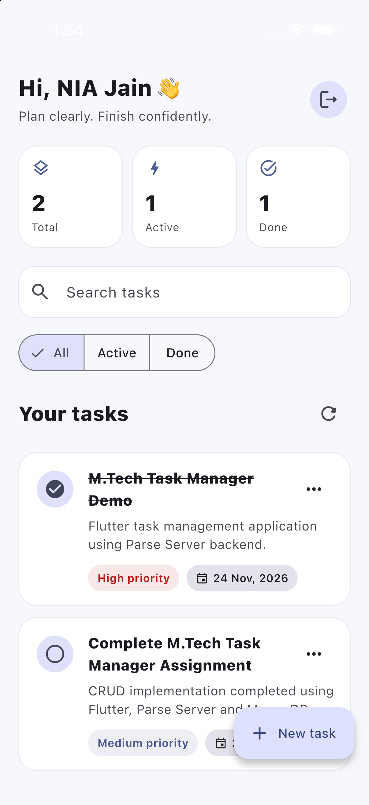
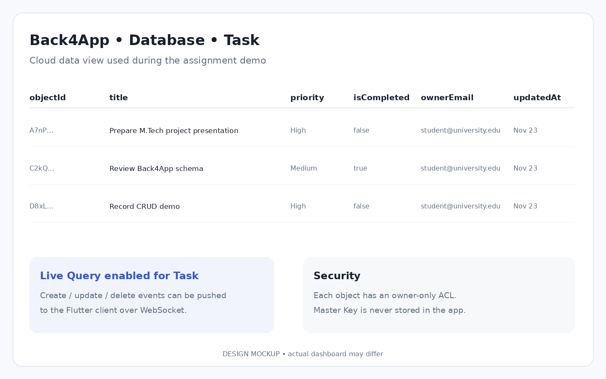

# M.Tech Task Manager — Flutter iOS + Back4App

**Start with [`START_HERE.md`](START_HERE.md).**

A polished iOS-first Flutter Task Manager built for the **SE ZG585 assignment**. It uses **Back4App (Parse Server) as Backend-as-a-Service** for student authentication, cloud task storage, CRUD operations, sessions, and Live Query syncing.

## Features

- Student email registration and login
- Persistent Parse user session
- Create, read, edit, complete, search, filter, and delete tasks
- Priority and optional due date
- Back4App cloud persistence
- Parse Live Query compatible real-time list
- Owner-only ACL on every task
- Secure logout
- iOS-friendly Material 3 interface
- Repo-safe runtime credentials via `--dart-define`
- Flutter tests for validation rules


## Interface preview

These are included **design mockups** for repository presentation; capture actual iPhone Simulator screenshots after you run the app.

| Login | Dashboard | Create task | Back4App cloud data |
|---|---|---|---|
|  |  |  |  |

## Assignment demo flow

**Register/Login → Create → Read → Update → Delete → Logout**

See `docs/VIDEO_SCRIPT_2_MIN.md` for an exact recording sequence.

## Quick start on macOS

```bash
# 1) Generate the standard Flutter iOS runner and install packages/pods
bash scripts/bootstrap_ios.sh

# 2) Create your private config
cp .back4app.env.example .back4app.env

# 3) Fill BACK4APP_APP_ID + BACK4APP_CLIENT_KEY
open .back4app.env

# 4) Start an iPhone Simulator
open -a Simulator

# 5) Run the app
bash scripts/run_ios.sh
```

For full setup, read:
- `docs/IOS_SETUP.md`
- `docs/BACK4APP_SETUP.md`
- `docs/CREDENTIALS_TEMPLATE.md`

## Back4App initialization

The app uses the official Parse Flutter package and initializes it from compile-time environment values. No live key is committed to the repository.

## Real-time syncing

CRUD works with the normal Back4App API. For real-time push updates, enable **Live Query** for `Task` in Back4App and provide your Live Query WebSocket endpoint in `.back4app.env`. The task list is implemented with `ParseLiveListWidget`.

## Security

- Passwords are handled by Parse `_User`, not stored in app code.
- The Master Key is never used client-side.
- `.back4app.env` is ignored by Git.
- Each task has an ACL allowing only its owner to access it through ordinary client requests.

## Project structure

```text
lib/
  config/       Back4App runtime configuration
  core/         Theme + reusable UI
  models/       Task model wrapper
  screens/      Auth, dashboard, add/edit task
  services/     Authentication + CRUD logic
  utils/        Validators
  widgets/      Task/stat cards
docs/           Setup, video script, schema, viva, mapping
scripts/        iOS bootstrap, run, quality checks
test/           Flutter unit tests
assets/         README/demo screenshots
```

## Submission package

The repository includes:
- source code
- setup/run instructions
- configuration template
- 2-minute video script
- requirement mapping
- Back4App schema/security notes
- GitHub/Taxila checklist
- viva Q&A
- PowerPoint presentation

> Replace the design mockups in `assets/screenshots/` with actual simulator screenshots before final submission if required by your faculty.
